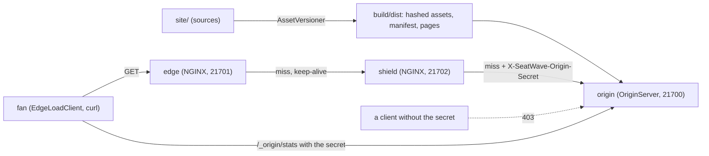

# Architecture of seatwave-cdn

SeatWave's static content behind a CDN stand-in: a header policy, a static origin, a build step that names assets after their bytes, a model of a shared cache tier, an NGINX edge and shield in front of the origin, and a load client. This is the project of Module 17, "CDN", of System Design Fundamentals.

## Packages

| Package | What it holds | Depends on |
|---|---|---|
| `http` | `CacheControl` (the response directives a shared cache acts on, parsed failing safe), `Reply`, `Upstream` and its `Request` | the JDK |
| `origin` | `HeaderPolicy` (the one place `Cache-Control` is decided) and `OriginServer` (files, strong ETags, `304`, counters, the shared-secret check) | `http`, result4j |
| `assets` | `AssetVersioner`: hashed names, the manifest, pages rendered from it | `origin` (in tests only), result4j |
| `edge` | `EdgeCache`: a model of one shared cache tier on a stepped clock, following RFC 9111 | `http` |
| `demo` | `EdgeRulesDemoCli`, `ReleaseDemoCli`, `OriginLoadCli`: the programs that print the module's model results and estimates | every package above |
| `load` | `EdgeLoadClient`: first visits over real HTTP, with hit ratio, origin load, throughput and latency | the JDK, result4j |

The dependency rule: `http` depends on nothing; `origin`, `assets`, `edge` and `load` depend only on `http` and the JDK (and result4j for refusals); only `demo` puts them together. Only the `main` methods print or exit.

## Data flow

## Walk-throughs

**A first visit through the stack.** The fan asks the edge for `/events/arena.html`. The edge's key is `$scheme://$host$request_uri`; on a miss it takes the cache lock and asks the shield over a warm connection; the shield does the same towards the origin and adds the secret header from `.secrets/origin-secret.conf`. The origin checks the secret in constant time, takes the header from `HeaderPolicy`, and answers with a strong ETag. Each tier stores the page for its `s-maxage` of 60 seconds; the fan then asks for the two `/static/` files the page names, which each tier keeps a year.

**A release.** `AssetVersioner` writes the new assets beside the old ones and the page last; `POST /_origin/deploy` makes the origin read the folder again. Fans keep getting the old page, whose old assets are still there, until each tier's copy of the page expires; then the new page names new files that every tier fetches once. Nothing is ever broken, because a name always means the same bytes.

**A purge.** Open-source NGINX has no purge command, so the lab purges a tier by restarting it: its cache is on `tmpfs`. Restarting only the edge shows the shield absorbing a cold edge; restarting both shows what the origin sees after a broad purge.

## Decisions and trade-offs

- **NGINX as the CDN stand-in**, the same image as Module 9 (`nginx:1.30.6`, the current stable line, checked on 12 November 2026). Varnish 9.1.0 was considered: it speaks `Age` and has bans, but NGINX keeps one tool across Modules 9 and 17. The price is NGINX's missing `Age` handling, which the module measures instead of hiding.
- **One template for both tiers.** The edge and the shield differ only in upstream and status header, so a rule cannot differ between them.
- **The origin runs the project's jar in the pinned Temurin JRE image**, mounted read-only from `build/stack/lib`, as user 10001 with a read-only root file system and no capabilities, instead of building an image: there is nothing to install, and no image is left to clean up. A production origin is object storage (Module 29).
- **The shared secret** is the origin's only access rule: generated per stack by `scripts/stack.sh up` into the ignored `.secrets/` folder (not under `build/`, which `./gradlew clean` deletes), written for the tiers as an NGINX directive and for curl as a header file, compared in constant time, and never logged. On `0.0.0.0` the origin refuses to start without it.
- **A load client inside the stack's network** (the `load` service, profile `tools`) measures the origin's and the edge's capacity without Docker Desktop's port forwarder, which limits the runs from the Mac.
- **The model (`EdgeCache`) beside the stack.** The stack has one edge and no distance; the model has 20 edges on five continents and a stepped clock, so its counts are exact. Each says what it measured.

## Invariants and where they are enforced

| Invariant | Enforced in | Tested by |
|---|---|---|
| No response containing personal data is ever cacheable at the edge | `HeaderPolicy` (personal and unknown paths `private, no-store`); `EdgeCache.mustBypass` and `storableLifetime`; the template's `location /v1/` and credential bypass | `PersonalResponsesNeverCachedTest`, `EdgeCacheTest`, `CdnTierConfigTest`, `StackTest` |
| No tier lengthens what the origin said | no `proxy_cache_valid` or `proxy_ignore_headers` in the template; `EdgeCache` stores only explicit lifetimes | `CdnTierConfigTest`, `EdgeCacheTest` |
| The origin answers only the CDN tiers | `OriginServer` (`403` without the secret; no start on `0.0.0.0` without one); the template's server-level `include` | `OriginServerTest`, `CdnTierConfigTest`, `StackTest` |
| A page never names a missing file | `AssetVersioner` checks every reference before writing, writes assets before pages, never deletes | `AssetVersionerTest` |
| Every port on 127.0.0.1 in 21700 to 21799; every image pinned by tag and digest | `compose.yaml` | `CdnTierConfigTest` |
